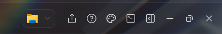

# zcode-bg

[中文](README.md) | English

A **wallpaper + translucent glass theme** for the [ZCode](https://zcode.z.ai) desktop app — and **fully reversible**.

> ⚠️ Unofficial third-party plugin. It modifies ZCode's client resources (see "How it works"). You must re-apply it after every ZCode update. Read "Risks & disclaimer" before use.

## Features

- 🖼️ **Wallpaper**: any local image, auto-compressed to a sensible size (max edge 2560px)
- 🎛️ **7 independent opacity controls**: window background / work-area cards / sidebar / group widgets / menus & popovers / input / global dim
- 🧩 **Toolbar palette button**: embedded in the ZCode toolbar; opens the panel, click outside to close
- 🖱️ **Sliders + exact numeric input**: 0–0.95, applied instantly
- 🔗 **Linked work-area + sidebar control**: one master slider drives both
- 💾 **5 custom preset slots**: save/apply, persisted across restarts
- 🌗 **Dark/light adaptive tints**: per-token tints (dark glass in dark mode, white glass in light mode) keep text readable in both
- ⚡ **Hot CSS reload**: changes apply in ~2 seconds, no ZCode restart
- 🧪 **Color probe**: click any UI region to dump 12 ancestor layers (classes + backgrounds) for self-diagnosis
- 🧯 **Pure mode**: restore the stock ZCode look (wallpaper hidden) with one click, exit anytime
- 🔒 **Zero telemetry, zero uploads**: everything stays local (the only network call is `npx` fetching the pinned official asar tool)

## How it works (fully auditable)

ZCode loads `resources/app.asar` first, and `resources/app/` only if the asar is absent. This plugin:

1. Extracts `app.asar` into `resources/app/` (once);
2. Injects the wallpaper, theme CSS, and the settings-panel script into the extracted directory;
3. Renames `app.asar` to `app.asar.disabled` so the extracted directory takes effect.

**It never rewrites the contents of app.asar.** Rollback = rename it back. All injected code is plain local CSS/JS with no reporting logic.

## Requirements

- Python 3.8+
- Node.js (for `npx @electron/asar`, pinned at 4.3.1)

## Install

### Option A: local directory (recommended for personal use)

1. Put `plugins/zcode-bg` anywhere (or clone the whole repo);
2. In ZCode: **Settings → Plugins → Add marketplace → Choose directory**, select the **repo root** containing `marketplace.json`;
3. Find **zcode-bg** in the marketplace and install;
4. Run `/bg-apply` (or let your assistant run `scripts/bg_patch.py apply`). ZCode must be fully quit (tray → Quit) when applying.

### Option B: run the script directly

```bash
python plugins/zcode-bg/scripts/bg_patch.py detect     # read-only status check
python plugins/zcode-bg/scripts/bg_patch.py apply --wallpaper <image path> --preset balanced
python plugins/zcode-bg/scripts/bg_patch.py rollback   # restore
```

`apply` / `rollback` require ZCode to be fully closed.

### Install-path detection order

`--asar` argument → `ZCODE_ASAR` env var → `asar_path` in the plugin's `config.json` → common locations (`%LOCALAPPDATA%\Programs\ZCode`, `Program Files`, `ZCode` / `App tools\ZCode` on each drive) → the running ZCode process path. If nothing matches, pass `--asar ...\resources\app.asar` explicitly.

## Usage

The panel entry lives in the toolbar — the palette icon **between the folder and upload buttons**:



- **Panel**: click the palette button → sliders / numeric inputs / wallpaper picker / preset slots
- **Commands** (after install): `/bg-apply`, `/bg-rollback`, `/bg-status`, `/bg-preset`, `/bg-wallpaper`, `/bg-alpha`
- **Pure mode**: button in the panel's "Diagnostics" section — restores the stock look while keeping your settings; exit anytime

## Risks & disclaimer

- This plugin **modifies ZCode client resources**. ZCode updates overwrite the injection; re-run `apply` afterwards (your panel settings are preserved).
- Not affiliated with ZCode. Modifying client software **may violate its terms of service**; use at your own risk.
- UI tokens and DOM structure change between versions. **Tested with ZCode v3.15.3 (Windows)**. If a region stops responding, use the built-in color probe and file an issue with its output.
- Always fully quit ZCode before applying. `rollback` restores everything; the extracted `resources/app/` directory can safely remain.

## Uninstall

1. Run `rollback` (or rename `app.asar.disabled` back to `app.asar`);
2. Uninstall the plugin from the plugin manager;
3. Optional: delete the extracted `resources/app/` directory.

## FAQ

**`python3` not found on Windows?**
On some systems `python3` points to a Microsoft Store stub. Make `python3` resolve to a real Python (e.g. copy `python.exe` to `python3.exe` in the Python install dir), or run the script with `python`.

**Light mode looks off no matter what?**
Light theme + a bright wallpaper has limited contrast headroom. The plugin supplies a white veil for light mode (the overlay slider); try overlay ≥ 0.2. Dark mode looks best with wallpapers.

**Why are GUI-selected images compressed?**
localStorage is capped (~5MB) and base64 inflates by 33%, so large originals cannot be stored. For lossless originals, switch wallpapers via the command (`hot wallpaper --path <path>`), which references the file directly instead of storing it.

**Which wins: panel settings or command settings?**
Panel (localStorage) wins. Pure mode clears temporary effects; your slider values are kept.

## Repository layout

```
marketplace.json              # marketplace manifest
plugins/zcode-bg/
├── .zcode-plugin/plugin.json # plugin manifest
├── assets/zcode-bg-panel.js  # settings panel (injected renderer script)
├── commands/*.md             # /bg-* commands
├── skills/zcode-bg/SKILL.md  # assistant skill docs
└── scripts/bg_patch.py       # detect / apply / rollback / hot
scripts/release.py            # build zip + sha256
```

## Credits

- The extract-directory injection / `app.asar.disabled` mechanism is based on
  [zcode-background-diy](https://github.com/Badboy000000/zcode-background-diy) (MIT).

## License

MIT — see [LICENSE](LICENSE).
